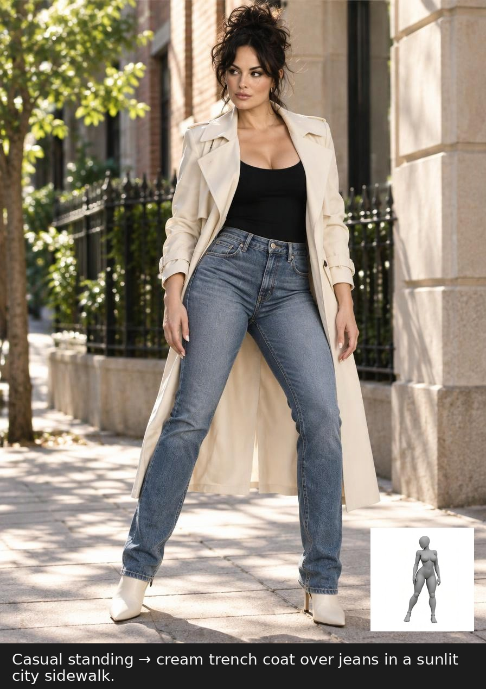
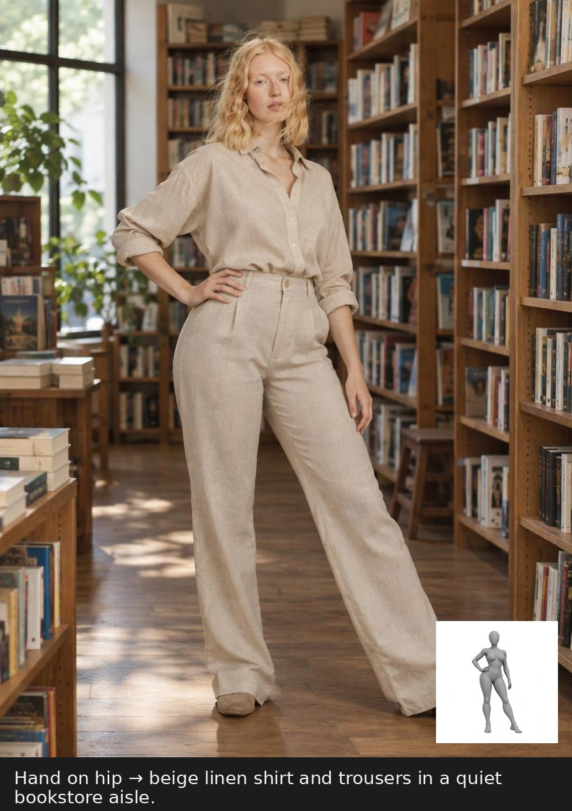
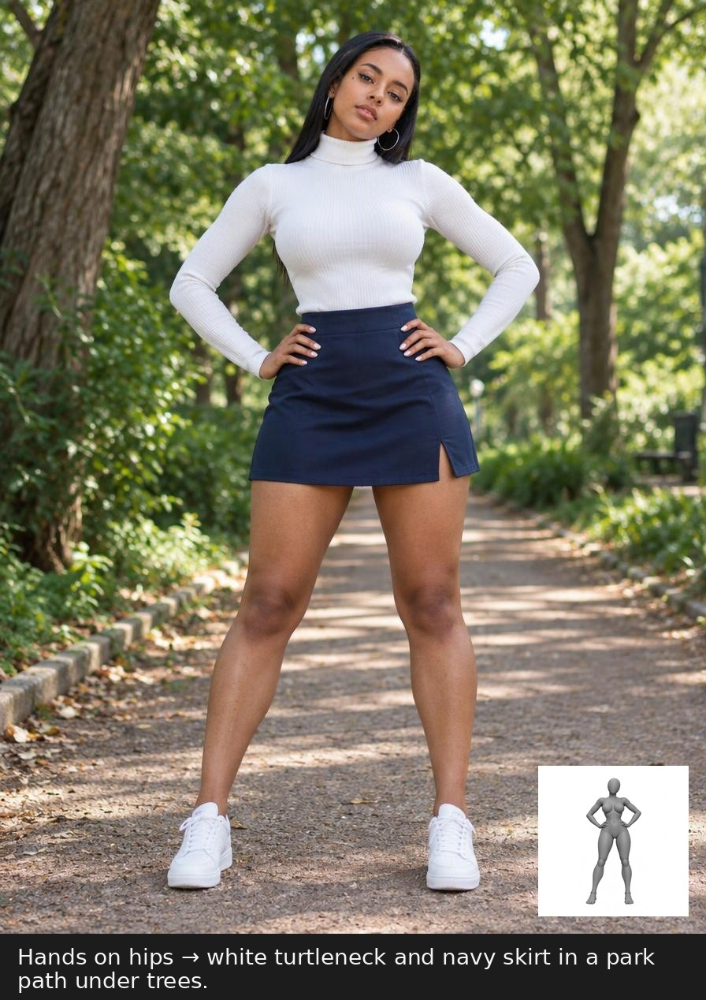
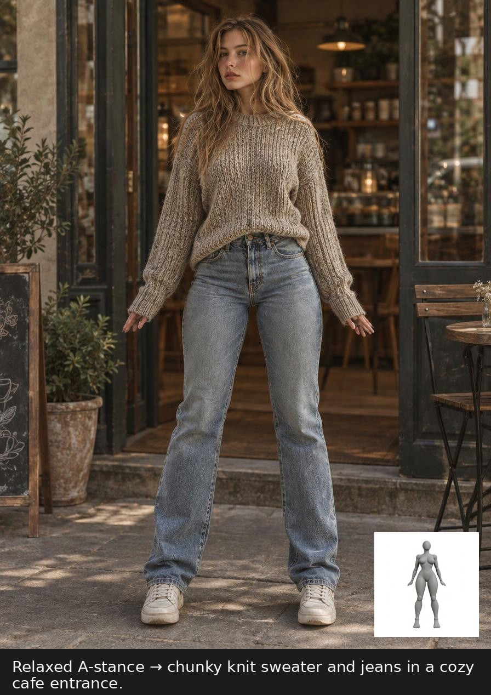
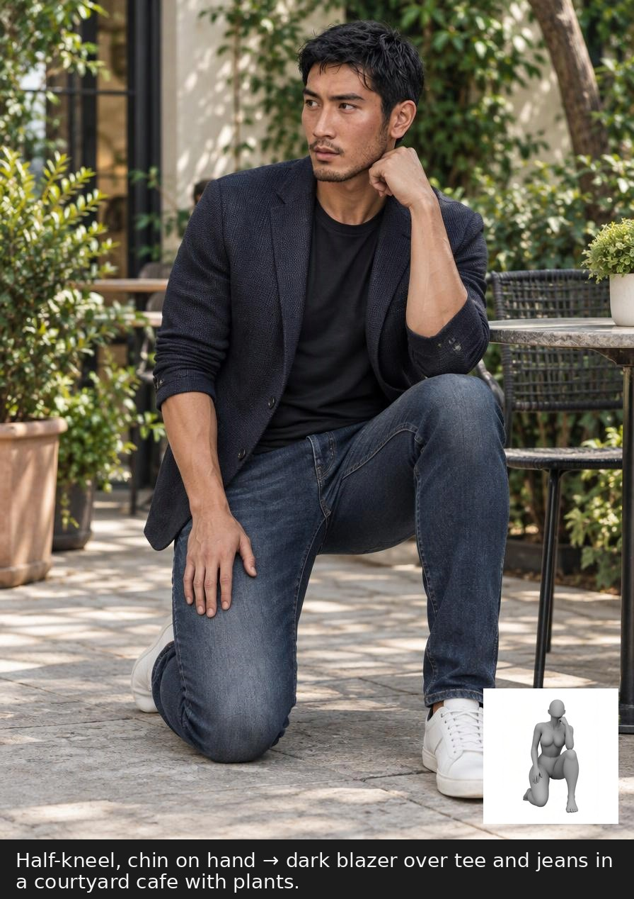
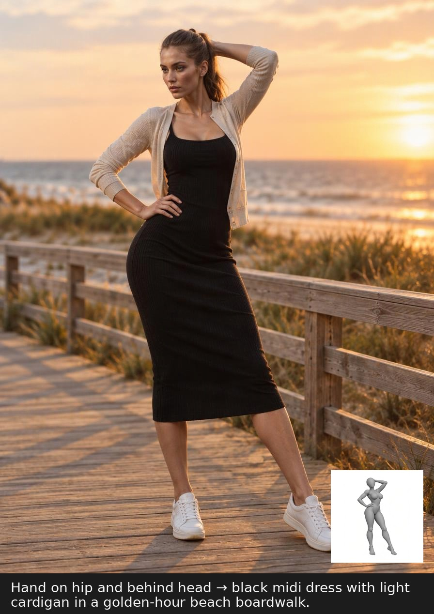
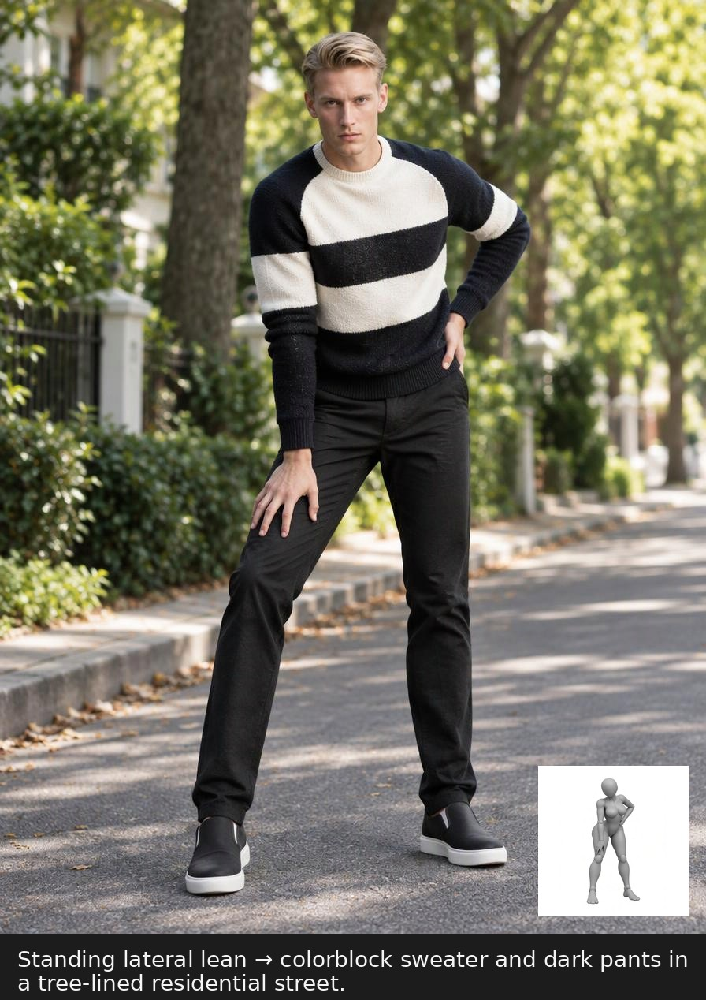
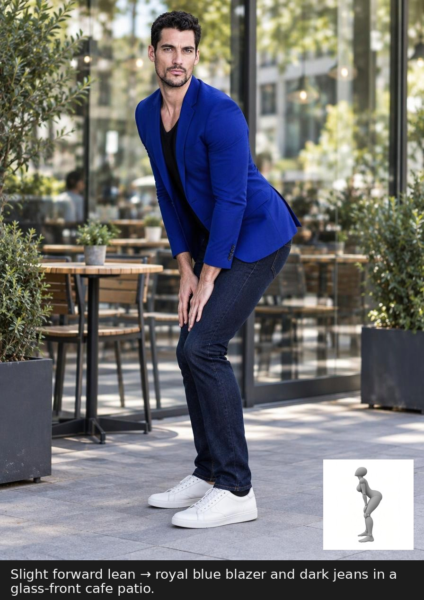

# Pose Library · Pose Reference

288 poses and 1,439 gray 3D mannequin images, in 4 series and 5 camera angles. The gallery is a place to study stance, line, and viewpoint before drawing, photographing, or designing a character.

Published site: [Pose Library · Pose Reference](https://pose-library-henna.vercel.app/)

## Open the gallery offline

1. Choose **Code → Download ZIP** and download this whole repository.
2. Extract the whole folder. `index.html` and `images/` have to stay together.
3. Double-click `index.html`.

Pose data is embedded in `index.html`, so the page opens without a network connection and without reading `poses.json`. Copying only the HTML file does not bring the pictures. All 1,439 JPGs are in the sibling `images/` folder.

## What the page does

- Filter by series, action category, and angle: front, side, 3/4, high, and low
- Search a name, an action tag, or an ID
- Save favorites in this browser. If storage is blocked, favorites still work until the page is closed
- Open a pose, switch angles, copy the image address, and download that view
- Move between poses with the arrow keys, and close with Esc
- Use a phone. With reduce-motion on, the cards do not tilt

`full_sexy_P018` (Wide Knee Squat) has no low image. That control stays off, and the card says the low view is missing. The page shows an angle that does exist.

Series counts: Glamour `full_sexy` 399, Full body `full_single` 365, Pairs `pair60` 275, Upper body `upper80v2` 400. Front, side, 3/4, and high have 288 images each. Low has 287.

## Example applications

These eight pictures are generated examples of applying a reference pose. The source gray mannequin stays inset on each card. They are not additional library files, and they do not replace the 1,439 images in `images/`.

<table>
  <tr>
    <td></td>
    <td></td>
    <td></td>
    <td></td>
  </tr>
  <tr>
    <td></td>
    <td></td>
    <td></td>
    <td></td>
  </tr>
</table>

## Files

| Path | Contents |
| --- | --- |
| `index.html` | Gallery page. The dataset is embedded. |
| `images/` | 1,439 reference JPGs, 126,617,727 bytes |
| `poses.json` | Local catalog. Each `url` is `images/<file>.jpg`. `sourceUrl` records where the file was collected; the page does not request it. |
| `metadata/poses-source.json` | Original metadata, unchanged |
| `metadata/SHA256SUMS` | SHA-256 for every reference JPG |
| `assets/readme/` | The eight generated example cards shown above |

After extracting the ZIP, the reference images can be checked with:

```bash
sha256sum -c metadata/SHA256SUMS
```

## Rights

The mannequin images were collected from the addresses stored in the original metadata so the gallery can be browsed offline. That metadata does not include a license or a commercial grant. This README does not grant copyright in those images or in the generated example cards, and it does not say that either set may be sold or redistributed.

## 中文

本库有 288 组姿势、1,439 张灰色 3D 人偶参考图，分为 4 个系列、5 个观察视角。可以先看清姿态、线条和机位，再用于绘画、摄影或角色设计。

已发布网站：[Pose Library · Pose Reference](https://pose-library-henna.vercel.app/)

### 离线打开

1. 选择 **Code → Download ZIP**，下载整个仓库。
2. 解压完整文件夹。`index.html` 必须和 `images/` 放在一起。
3. 双击 `index.html`。

姿势数据写在 `index.html` 里，所以不需要联网，也不需要再读取 `poses.json`。只复制 HTML 不会带上图片。1,439 张 JPG 都在同级的 `images/` 目录中。

### 页面可以做什么

- 按系列、动作分类和视角筛选：正面、侧面、斜侧（3/4）、俯视、仰视
- 搜索名称、动作标签或编号
- 在这台浏览器里收藏。如果浏览器不允许保存，本次打开期间仍可收藏，关闭后不会记住
- 打开大图，切换视角，复制图片地址，下载当前这张图
- 用方向键切换姿势，用 Esc 关闭
- 可以在手机上使用。系统开启“减少动态效果”时，卡片不再倾斜

`full_sexy_P018`（Wide Knee Squat）没有仰视图。仰视按钮保持不可用，卡片会写明缺少仰视，并显示一张实际存在的视角。

系列张数：魅力姿态 `full_sexy` 399，单人全身 `full_single` 365，双人互动 `pair60` 275，半身特写 `upper80v2` 400。正面、侧面、斜侧、俯视各 288 张，仰视 287 张。

上文两行四列的图片，是把参考姿势做成摄影画面的生成示例。每张右下角保留了原来的灰色人偶。它们不是图库新增的参考图，也不能代替 `images/` 里的 1,439 张文件。

### 使用范围

灰色人偶图按原始元数据里的地址整理进来，方便离线查看。这份元数据没有写明许可协议，也没有商业授权。本说明不授予人偶图或生成示例的版权，也不表示这些图片可以出售或再分发。
